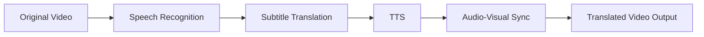

# Core Video Translation Feature

This article provides a detailed explanation of pyVideoTrans's most essential feature — video translation. It covers the complete workflow from file selection to final output.

---

## Overview

Video translation is the core function of pyVideoTrans. It automatically translates a video from one language to another and adds dubbed audio in the target language.



**Supported files**: Any audio or video file containing clear human speech.

**Unsupported files**: Videos with only background music or visuals and no spoken words.

> ⚠️ This feature cannot directly extract or remove hard-burned subtitles (text burned into the video frames). To extract hard subtitles, use the [Hard Subtitle Extraction Tool](https://pyvideotrans.com/ocrsp).

---

## Basic Workflow

1. Select the original video to translate
2. Choose an ASR channel and model
3. Select the spoken language and target language
4. Choose a translation channel
5. Select a dubbing channel and voice actor
6. Adjust sync, alignment, and subtitle settings
7. Click Start

---

## Main Interface Parameters

### Row 1: Select A/V

Supported formats:
- Video: mp4, mkv, avi, mov, webm, mpeg, ogg, mts, ts, wmv
- Audio: wav, mp3, m4a, flac, aac, wma

| Option | Description |
|--------|-------------|
| Select A/V | Select one or more files (hold Ctrl for multi-select) |
| Folder | Check to batch-process an entire folder |
| Clean Output | Check to force reprocessing without using cache |
| Save to... | Set the output directory for translated videos |
| OutputOnly MP4 | When selected, only the final video is kept; other files are automatically deleted |
| Shutdown on Finish | Automatically shuts down the computer after all tasks are complete |

### Row 2: ASR Channel

| Provider | Recommended For | Description |
|----------|----------------|-------------|
| `faster-whisper (Local Built-in)` | **Default recommendation** | Fast and high quality, supports GPU acceleration |
| `openai-whisper (Local Built-in)` | High accuracy needs | Slightly more accurate, slower |
| `Qwen-ASR (Local Built-in)` | Chinese video | Excellent Chinese recognition |
| `FunASR-Chinese (Local Built-in)` | Chinese video | By Alibaba, optimized for Chinese |
| `Huggingface_ASR (Local Built-in)` | Multi-language | Supports multiple language models |

Model selection (faster-whisper / openai-whisper):
- `tiny` → Fastest, low accuracy
- `base` / `small` → Balanced choice
- `medium` → Good quality
- `large-v3` → Best quality, requires 8GB+ VRAM
- `large-v3-turbo` → **Recommended**, best balance of speed and quality

> Second Pass Recognition: After dubbing is complete, performs another round of speech recognition on the dubbed audio to generate more precise subtitle timecodes. Ideal for scenarios requiring tight alignment between subtitles and dubbing.

### Row 3: Translation

| Provider | Description |
|----------|-------------|
| `Google (Free)` | Good translation quality; requires network proxy |
| `Microsoft (Free)` | No proxy needed; may be rate-limited |
| `M2M100 (Local)` | Local model translation |

- **Spoken Lang**: The language spoken in the video — must be selected correctly
- **Target Lang**: The language you want to translate into

> A "-" in the spoken language list means no language is selected. Make sure to choose the correct language.

### Row 4: Dubbing

| Provider | Description |
|----------|-------------|
| `Edge-TTS (Free)` | **Default recommendation**; Microsoft's free interface with natural voices |
| `Qwen3-TTS (Local Built-in)` | Alibaba's local model; supports Chinese, English, Japanese, Korean, etc. |
| `MOSS-TTS-Nano (Local Built-in)` | Supports multiple languages |
| `Piper (Local Built-in)` | Lightweight local TTS |
| `VITS (Local Built-in)` | Chinese-English dubbing |
| `Supertonic3 (Local Built-in)` | Multi-language |
| `ChatterBox (Local Built-in)` | Multi-language, high quality |
| `gTTS (Free)` | Google TTS, basic quality |

After selecting a provider, the **Select Voice** dropdown automatically updates with the available voices for that provider.

> Selecting `clone` for the dubbing voice means the dubbing will use the voice timbre from the original video (voice cloning).

### Row 5: Sync, Alignment & Subtitles

| Parameter | Default | Description |
|-----------|---------|-------------|
| Dubbing Speedup+ | ✅ Enabled | Speeds up dubbing when it is longer than the original video |
| Slow Video | ☐ Disabled | Slows down the video when dubbing is longer than the original |
| Dubbing Rate | 0% | Adjusts dubbing speed (−50% to +50%) |
| Volume+ | 0% | Adjusts dubbing volume (−95% to +100%) |
| Pitch+ | 0Hz | Adjusts dubbing pitch (−100Hz to +100Hz) |
| Subtitle Type | Embed Hard Subs | How subtitles are embedded |

Subtitle embedding types:
- **No subtitles**: Replaces audio only, no subtitles added
- **Embed Hard Subs**: Subtitles permanently burned into the video; visible in any player
- **Embed Soft Subs**: Subtitles as a separate track; togglable in the player
- **Embed Hard Subs (Bilingual)**: Shows both original and translated text simultaneously
- **Embed Soft Subs (Bilingual)**: Bilingual subtitle track; togglable in the player

### Row 6: Start

Click the **🚀 Start** button to begin processing. The button changes to "⏳ Processing..." and is disabled to prevent duplicate clicks.

### Row 7: Progress Bar

After processing is complete, click the progress bar area at the bottom to open the output folder and view the translated video, subtitles, dubbing audio, and other files.

### Row 8: More Settings

Click to expand and configure:

| Parameter | Description |
|-----------|-------------|
| Denoise | Removes background noise from audio |
| Delete punctuati... / Restore Punctuation | Controls punctuation in subtitles |
| Split Vocal/BGM | Separates vocals from background music (slower processing) |
| Re-embed BGM | Re-embeds background audio after separation |
| Background Audio Mode | Truncate / Loop background audio |
| Background Volume | Adjusts background volume (0.0–2.0) |

---

## Processing Stages

After clicking Start, the software processes through the following 8 stages:

```
Stage 1/8: Preprocessing (separate audio from video)
Stage 2/8: Speech Recognition
Stage 3/8: Speaker Diarization
Stage 4/8: Subtitle Translation
Stage 5/8: Dubbing Generation
Stage 6/8: Audio-Visual Alignment
Stage 7/8: Second Pass Recognition
Stage 8/8: Final Composition
```

The log area on the right displays real-time progress for each stage.

---

## Single Video Interactive Mode

When a single video is selected, the software enters interactive mode:

1. After speech recognition, a subtitle editor window pops up where you can modify the recognized text
2. After translation, a translation subtitle editor window appears where you can edit translations and assign dubbing roles to each speaker
3. After dubbing, a dubbing result editor window lets you preview and re-dub
4. After second pass recognition (if enabled), the subtitle editor window appears again

Each editor window has a countdown timer (default 30 seconds). When it expires, changes are auto-saved and processing continues. Click "Stop Countdown" to pause.

---

## Lossless Video Output

To preserve the original video quality in the output, ensure **all** of the following conditions are met:

1. The original video is encoded as **H.264 (libx264)** in MP4 format
2. **Slow Video** is unchecked
3. Subtitle type is set to **No subtitles** or **Embed Soft Subs**
4. In Advanced Options, the 264/265 encoder is set to `264`

> Note: If the dubbed audio duration exceeds the original video length, the excess will be trimmed. In that case, enable **Dubbing Speedup+** or increase the dubbing rate.

---

## Output Files

After translation is complete, output files are saved to the `output/<filename>/` directory:

| File Type | Description |
|-----------|-------------|
| MP4 | Translated video file |
| SRT | Target language subtitle file |
| WAV | Dubbing audio file |
| Original subtitles | Subtitles generated by speech recognition (if available) |

---
